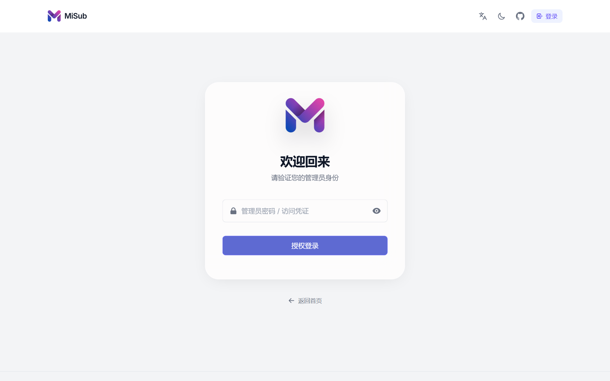
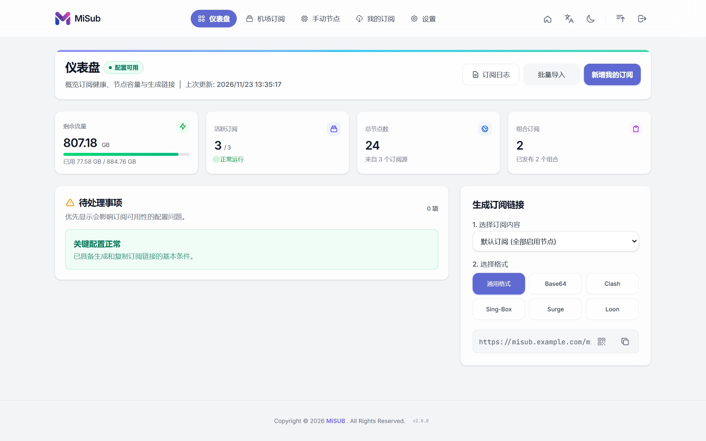

# MiSub

> [English](README.md) | [中文](README-zh.md) | **Türkçe**

<div align="center">

**Proxy düğümlerini düzenlemek, istemciye hazır abonelikler üretmek ve düğüm işleme akışları oluşturmak için hafif bir abonelik yönetim paneli.**

[](LICENSE)
[](https://pages.cloudflare.com/)
[](https://vuejs.org/)
[](#sürüm)

[Özellikler](#özellikler) • [Hızlı Başlangıç](#hızlı-başlangıç) • [Dağıtım](#dağıtım) • [Kullanım](#kullanım) • [Belgeler](#belgeler)

</div>

---

## Genel Bakış

MiSub, yukarı akış (upstream) aboneliklerini ve elle eklenen düğümleri yönetmenize, bunları profillerde birleştirmenize, görsel bir operatör zinciriyle işlemenize ve yaygın proxy istemcileri için abonelik bağlantıları yayımlamanıza yardımcı olur.

Kişisel ve küçük ekip kullanımları için tasarlanmıştır: basit işlemler, net istemci bağlantıları, güvenli varsayılanlar ve esnek Cloudflare Pages dağıtımı sunar.

## Ekran Görüntüleri

<div align="center">

| Giriş | Gösterge Paneli |
|------|-----------|
|  |  |

</div>

## Özellikler

- **Profiller**: Yukarı akış aboneliklerini ve elle eklenen düğümleri senaryoya özel abonelik profillerinde birleştirin (profiller içinde iç içe profiller dahil).
- **Profil bağlantıları**: Her profil, sunucu tarafından doğrulanan ve sıfırlanabilen bir `linkId` altında yayımlanır; kullanımdan kaldırılan kimlikler çalışmayı durdurur.
- **Abonelik ve düğüm yönetimi**: Sağlayıcı aboneliklerini, manuel düğümleri, grupları, sıralamayı, açıklamaları, trafik ve süre sonu bilgilerini yönetin.
- **Operatör Zinciri**: Düğümleri filtreleme, regex ile yeniden adlandırma, betik/DSL yürütme, sıralama ve akıllı tekilleştirme adımlarıyla işleyin.
- **Çoklu istemci çıktısı**: Clash/Mihomo, Sing-Box, Surge, Loon, Quantumult X, Shadowrocket, V2rayN/V2rayNG ve base64 istemcileri için abonelik çıktısı üretin.
- **Yerleşik şablonlar**: Birleşik şablon çıktısı, kural seti ön ayarları, bölge grupları, politika grupları ve özel kural şablonları kullanın.
- **Özel herkese açık sayfa**: Temizlenmiş HTML oluşturma ile herkese açık bir keşif sayfası veya özel/gizleme sayfası yayımlayın.
- **Depolama seçenekleri**: Basit dağıtımlar için Cloudflare KV veya daha yüksek yazma hacmi ve yapılandırılmış depolama için Cloudflare D1 kullanın; D1 ile isteğe bağlı düğüm anlık görüntüleri abonelik çıktısını doğrudan veritabanından sunabilir ve büyük anlık görüntüleri parçalayabilir.
- **Bildirimler ve operasyonlar**: Telegram bildirimleri, zamanlanmış yenileme, yedekleme/geri yükleme (WebDAV gönderimi ve uzaktan geri yükleme dahil), günlükler ve tanılama desteği.
- **Harici yönetim API'si**: Bearer belirteciyle korunan `/api/ext/v1` uç noktaları üzerinden abonelikleri, düğümleri ve profilleri betiklerle yönetin.
- **Modern arayüz**: Açık/koyu temalar ve İngilizce/Çince dil desteğine sahip duyarlı Vue 3 arayüzü.

## Desteklenen Protokoller

- Shadowsocks / SS2022
- VMess
- VLESS
- Trojan
- Hysteria2 / HY2
- TUIC
- Snell
- WireGuard
- AnyTLS
- HTTPS
- SOCKS5 / SOCKS5-TLS

## Desteklenen Çıktı Biçimleri

- `clash` / Mihomo YAML
- `surge`
- `loon`
- `quanx`
- `singbox`
- `base64`
- harici dönüştürücü arka uç kipi

## Hızlı Başlangıç

### Ön Koşullar

- Bir GitHub hesabı
- Bir Cloudflare hesabı
- Yerel geliştirme için Node.js 20+

### Cloudflare Pages'e Dağıtma

1. Bu depoyu forklayın.
2. Cloudflare Kontrol Panelini açın.
3. `Workers & Pages` → `Create application` → `Pages` → `Connect to Git` yolunu izleyin.
4. Forkladığınız depoyu seçin.
5. Derleme ayarlarını yapılandırın:
   - Framework preset: `Vue`
   - Build command: `npm run build`
   - Build output directory: `dist`
6. Projeyi dağıtın.
7. Üretim kullanımından önce depolama bağlantısını yapın.

## Dağıtım

### Zorunlu KV bağlantısı

Bir Cloudflare KV ad alanı oluşturun veya seçin, ardından Pages ayarlarından bağlayın:

- Değişken adı: `MISUB_KV`
- Bağlantı türü: KV namespace

### İsteğe bağlı D1 bağlantısı

Abonelikleri sık sık yeniliyorsanız veya yapılandırılmış depolama istiyorsanız D1 önerilir.

```bash
wrangler d1 create misub
wrangler d1 execute misub --file=schema.sql --remote
```

Veritabanını Pages ayarlarından bağlayın:

- Değişken adı: `MISUB_DB`
- Bağlantı türü: D1 database

Şema başlatma CLI üzerinde başarısız olursa, en güncel `schema.sql` dosyasını Cloudflare D1 konsolunda elle çalıştırın.

### Önerilen ortam değişkenleri

- `ADMIN_PASSWORD`: Yönetici giriş parolası. Tanımlanmazsa varsayılan parola `admin` olur.
- `COOKIE_SECRET`: Kararlı oturum imzalama gizli anahtarı.
- `CORS_ORIGINS`: API istekleri için izin verilen tarayıcı kaynakları.
- `CRON_SECRET`: Harici cron tetikleyicileri tarafından kullanılan gizli anahtar.
- `MISUB_PUBLIC_URL`: Abonelik dönüştürme geri çağrı URL'lerini oluşturmak için kullanılan herkese açık site URL'si.
- `MISUB_CALLBACK_URL`: Abonelik dönüştürme için geri çağrı taban URL'si. `MISUB_PUBLIC_URL` değerine göre önceliklidir.

Gerçek belirteçleri, çerezleri, UUID/özel anahtarları, webhook gizli anahtarlarını, bot belirteçlerini, abonelik URL'lerini veya sağlayıcı alan adlarını asla commit etmeyin.

### Forkunuzu güncel tutma

`.github/workflows/fork-sync.yml` iş akışı forklarda günde bir kez **Pekin saatiyle 06:00'da** (bir önceki gün 22:00 UTC — GitHub cron alanları yalnızca UTC kabul eder) çalışır ve yukarı akış `imzyb/MiSub` `main` dalını sizin `main` dalınıza **birleştirir (merge)**. Adım günlükleri ve çalışma özeti her zaman Pekin saatini yazar. Dalı asla sıfırlamaz ve zorla gönderim (`force-push`) yapmaz:

- yeni yukarı akış commit'i yoksa: atlanır;
- temiz birleştirme: birleştirilir (gerektiğinde birleştirme commit'iyle) ve gönderilir; kendi commit'leriniz korunur;
- çakışan değişiklikler: birleştirme geri alınır, hiçbir şey gönderilmez ve çalışma özeti çakışan dosyaları listeler.

Yukarı akış değişikliği `.github/workflows/**` dosyalarına dokunuyorsa varsayılan `GITHUB_TOKEN` bunu gönderemez. Bu eşitlemelerin çalışmaya devam etmesi için bir `SYNC_PAT` gizli anahtarı (`Contents: Read and write` ve `Workflows: Write`) ekleyin; aksi hâlde o çalışma atlanır. Hâlâ eski yansıtma (mirror) tarzı iş akışında olan forklar, bir kez elle `Sync fork` yapıldıktan sonra yeni sisteme geçer.

Çakışmaları yerel olarak `git fetch upstream && git merge upstream/main` ile çözün, ardından gönderin. Otomasyonu duraklatmak için Actions sekmesinden `Fork Sync` iş akışını devre dışı bırakın.

## Yerel Geliştirme

```bash
npm install
npm run dev
```

Geliştirme sunucusu `0.0.0.0` üzerinde dinler; bu nedenle aynı yerel ağdaki (LAN) telefonlar ve diğer cihazlar doğrudan `http://<yerel-ip-adresiniz>:5173` adresini açabilir. Yerel Pages Functions testi için:

```bash
npm run dev:server -- --kv MISUB_KV --persist-to .wrangler/state-local
```

`dev:server` da tüm ağ arayüzlerine bağlanır (`--ip 0.0.0.0`); yalnızca yerel erişime ihtiyacınız varsa `--ip 127.0.0.1` ile kısıtlayın.

Faydalı komutlar:

```bash
npm test -- --run
npm run build
npm run preview
```

> Bir profilin herkese açık bağlantısı **Abonelik Kimliği (Subscription ID)** tarafından belirlenir (önce özel kimlik, sonra otomatik oluşturulan kimlik). Bunu değiştirmek veya yeniden oluşturmak önceki bağlantıyı anında geçersiz kılar — bkz. [docs/profile-url.md](docs/profile-url.md).

## Kullanım

1. Yönetici paneline giriş yapın.
2. Yukarı akış aboneliklerini veya manuel düğümleri ekleyin.
3. Seçilen kaynakları ve manuel düğüm gruplarını birleştiren profiller oluşturun.
4. Filtreleme, yeniden adlandırma, sıralama veya tekilleştirme gerekiyorsa operatör zincirini yapılandırın.
5. Oluşturulan istemci bağlantısını veya QR kodunu kopyalayın.
6. Bağlantıyı tercih ettiğiniz proxy istemcisine aktarın.

## Operatör Zinciri

Profiller genel bir varsayılan operatör zincirini devralabilir veya kendi işleme akışlarını tanımlayabilir. Kullanılabilir operatörler şunlardır:

- Düğümleri protokol, bölge, dahil etme regex'i veya hariç tutma regex'ine göre filtreleme.
- Düğümleri regex değiştirme veya şablonlarla yeniden adlandırma.
- Kısıtlı betik/DSL işlemleri uygulama.
- Düğümleri ağırlıklı koşullar ve özel bölge önceliğine göre sıralama.
- Protokol farkındalığına sahip akıllı kurallarla düğümleri tekilleştirme.

Ayrıntılar için [Operatör Zinciri Kılavuzu](docs/OPERATOR_CHAIN_GUIDE.md) belgesine bakın.

## Güvenlik Notları

- Yönetici API'leri parola/oturum ile korunur.
- Özel herkese açık HTML oluşturulmadan önce temizlenir (sanitize).
- Kullanıcı tarafından sağlanan betikler ana sayfa bağlamında çalıştırılmaz.
- Harici kaynak yükleme ve iframe URL'leri oluşturucu politikasıyla kısıtlanır.
- Abonelik getirme ve önizleme akışları SSRF odaklı koruma önlemleri içerir.
- `ADMIN_PASSWORD`, `COOKIE_SECRET` ve `CRON_SECRET` için güçlü gizli anahtarlar kullanın.

## Belgeler

- [İngilizce README](README.md)
- [Çince README](README-zh.md)
- [Harici API Kullanım Kılavuzu](docs/external-management-api-usage.md)
- [Harici API Referansı](docs/external-management-api.md)
- [Harici API OpenAPI Spesifikasyonu](docs/external-management-api.openapi.yaml)
- [Operatör Zinciri Kılavuzu](docs/OPERATOR_CHAIN_GUIDE.md)
- [v2.5.0 Yükseltme Kılavuzu](docs/UPGRADE_V2.5.md)
- [Mimari](docs/architecture.md)
- [Veri Modeli](docs/data-model.md)

## Sürüm

Mevcut sürüm: `v2.8.0`

Ayrıntılı geçmiş değişiklikler için [README-zh.md](README-zh.md) dosyasına ve depo commit geçmişine bakın.

## Teşekkürler

Proje sunucusunu desteklediği için sponsor [ForZTN](https://sponsorship.forztn.com/github/imzyb/MiSub)'ye teşekkürler.

MiSub, [CF-Workers-SUB](https://github.com/cmliu/CF-Workers-SUB) temel alınarak geliştirilmiştir. Açık kaynak katkısı için CM'ye teşekkürler.

## Lisans

MIT Lisansı. Bkz. [LICENSE](LICENSE).
