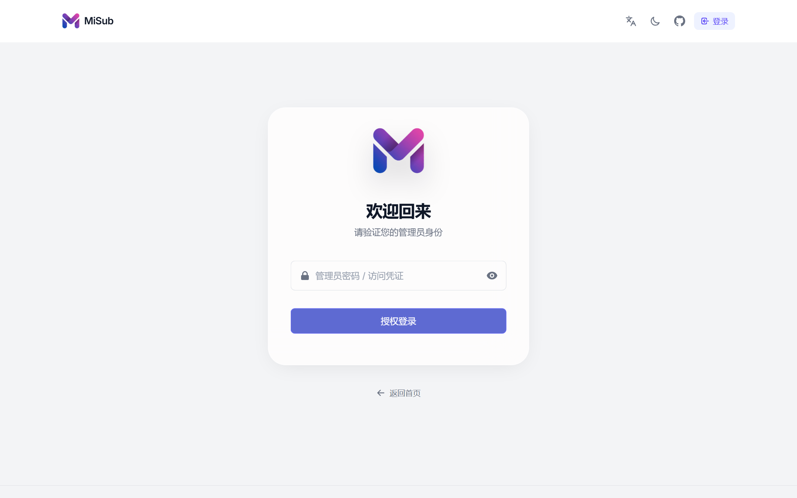
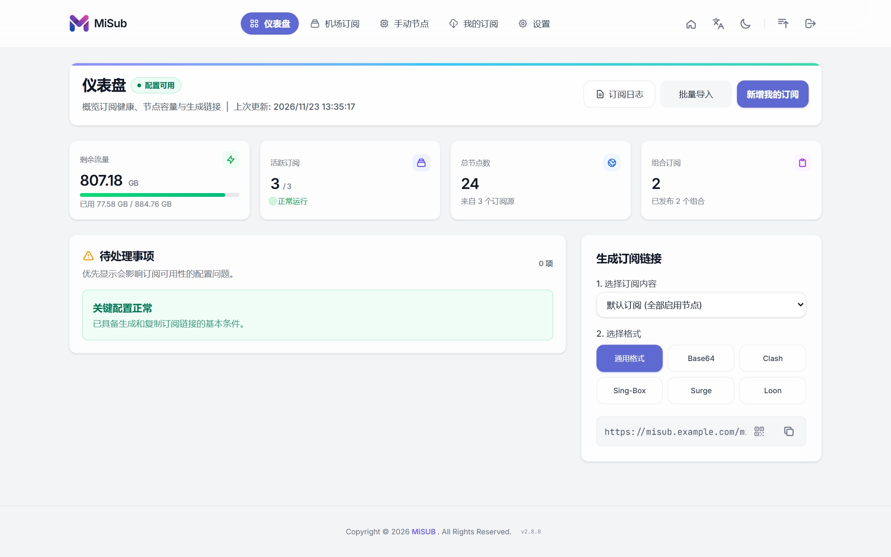

# MiSub

> 中文说明请见 [README-zh.md](README-zh.md)。

<div align="center">

**A lightweight subscription management panel for organizing proxy nodes, generating client-ready subscriptions, and composing node-processing workflows.**

[](LICENSE)
[](https://pages.cloudflare.com/)
[](https://vuejs.org/)
[](#version)

[Features](#features) • [Quick Start](#quick-start) • [Deployment](#deployment) • [Usage](#usage) • [Documentation](#documentation)

</div>

---

## Overview

MiSub helps you manage upstream subscriptions and manual nodes, combine them into profiles, process nodes through a visual operator chain, and publish subscription links for common proxy clients.

It is designed for personal and small-team usage: simple operations, clear client links, safe defaults, and flexible Cloudflare Pages deployment.

## Screenshots

<div align="center">

| Login | Dashboard |
|------|-----------|
|  |  |

</div>

## Features

- **Profiles**: combine upstream subscriptions and manual nodes into scenario-specific subscription profiles, including nested profiles inside profiles.
- **Profile links**: every profile is published under a server-validated, resettable `linkId`; retired identifiers stop working.
- **Subscription and node management**: manage airport subscriptions, manual nodes, groups, ordering, remarks, traffic, and expiry data.
- **Operator Chain**: process nodes with filter, regex rename, script/DSL execution, sorting, and smart deduplication steps.
- **Multi-client output**: generate subscription output for Clash/Mihomo, Sing-Box, Surge, Loon, Quantumult X, Shadowrocket, V2rayN/V2rayNG, and base64 clients.
- **Built-in templates**: use unified template output, rule-set presets, region groups, policy groups, and custom rule templates.
- **Custom public page**: publish a public explore page or an immersive disguise/custom page with sanitized HTML rendering.
- **Storage options**: use Cloudflare KV for simple deployments or Cloudflare D1 for higher write volume and structured storage; with D1, optional node snapshots can serve subscription output straight from the database, sharding oversized snapshots.
- **Notifications and operations**: support Telegram notifications, scheduled refresh, backup/restore (including WebDAV push and remote restore), logs, and diagnostics.
- **External management API**: manage subscriptions, nodes, and profiles from scripts through the Bearer-token protected `/api/ext/v1` endpoints.
- **Modern UI**: responsive Vue 3 interface with light/dark modes and English/Chinese localization.

## Supported Protocols

- Shadowsocks / SS2022
- VMess
- VLESS
- Trojan
- Hysteria2 / HY2
- TUIC
- Snell
- WireGuard
- AnyTLS
- HTTPS
- SOCKS5 / SOCKS5-TLS

## Supported Output Formats

- `clash` / Mihomo YAML
- `surge`
- `loon`
- `quanx`
- `singbox`
- `base64`
- external converter backend mode

## Quick Start

### Prerequisites

- A GitHub account
- A Cloudflare account
- Node.js 20+ for local development

### Deploy to Cloudflare Pages

1. Fork this repository.
2. Open Cloudflare Dashboard.
3. Go to `Workers & Pages` → `Create application` → `Pages` → `Connect to Git`.
4. Select your forked repository.
5. Configure build settings:
   - Framework preset: `Vue`
   - Build command: `npm run build`
   - Build output directory: `dist`
6. Deploy the project.
7. Bind storage before production use.

## Deployment

### Required KV binding

Create or select a Cloudflare KV namespace, then bind it in Pages settings:

- Variable name: `MISUB_KV`
- Binding type: KV namespace

### Optional D1 binding

D1 is recommended when you refresh subscriptions frequently or want structured storage.

```bash
wrangler d1 create misub
wrangler d1 execute misub --file=schema.sql --remote
```

Bind the database in Pages settings:

- Variable name: `MISUB_DB`
- Binding type: D1 database

If schema initialization fails in the CLI, run the latest `schema.sql` manually in the Cloudflare D1 console.

### Recommended environment variables

- `ADMIN_PASSWORD`: admin login password. If unset, the default password is `admin`.
- `COOKIE_SECRET`: stable session signing secret.
- `CORS_ORIGINS`: allowed browser origins for API requests.
- `CRON_SECRET`: secret used by external cron triggers.
- `MISUB_PUBLIC_URL`: public site URL used to generate subscription conversion callback URLs.
- `MISUB_CALLBACK_URL`: callback base URL for subscription conversion. It takes precedence over `MISUB_PUBLIC_URL`.

Never commit real tokens, cookies, UUID/private keys, webhook secrets, bot tokens, subscription URLs, or airport domains.

### Keeping your fork up to date

`.github/workflows/fork-sync.yml` runs in forks once a day at **06:00 Beijing time** (22:00 UTC the previous day — GitHub cron fields only accept UTC) and **merges** upstream `imzyb/MiSub` `main` into your `main`. Step logs and the run summary always print Beijing time. It never resets the branch and never force-pushes:

- no new upstream commits: skipped;
- clean merge: merged (with a merge commit when needed) and pushed; your own commits are kept;
- conflicting changes: the merge is rolled back and nothing is pushed, and the run summary lists the conflicting files.

If the upstream change touches `.github/workflows/**`, the default `GITHUB_TOKEN` cannot push it. Add a `SYNC_PAT` secret (`Contents: Read and write` and `Workflows: Write`) to keep those syncs working; otherwise that run is skipped. Forks still on the old mirror-style workflow switch over after one manual `Sync fork`.

Resolve conflicts locally with `git fetch upstream && git merge upstream/main`, then push. To pause automation, disable the `Fork Sync` workflow in the Actions tab.

## Local Development

```bash
npm install
npm run dev
```

The dev server listens on `0.0.0.0`, so phones and other devices on the same LAN can open
`http://<your-lan-ip>:5173` directly. For local Pages Functions testing:

```bash
npm run dev:server -- --kv MISUB_KV --persist-to .wrangler/state-local
```

`dev:server` also binds all interfaces (`--ip 0.0.0.0`); restrict it with `--ip 127.0.0.1`
if you only need local access.

Useful commands:

```bash
npm test -- --run
npm run build
npm run preview
```

> A profile's public link is driven by its **Subscription ID** (custom ID first, then the auto-generated one). Changing or regenerating it invalidates the previous link immediately — see [docs/profile-url.md](docs/profile-url.md).

## Usage

1. Log in to the admin panel.
2. Add upstream subscriptions or manual nodes.
3. Create profiles that combine selected sources and manual-node groups.
4. Configure the operator chain if you need filtering, renaming, sorting, or deduplication.
5. Copy the generated client link or QR code.
6. Import the link into your preferred proxy client.

## Operator Chain

Profiles can inherit a global default operator chain or define their own processing flow. Available operators include:

- Filter nodes by protocol, region, include regex, or exclude regex.
- Rename nodes with regex replacement or templates.
- Apply restricted script/DSL operations.
- Sort nodes by weighted conditions and custom region priority.
- Deduplicate nodes with protocol-aware smart rules.

See [Operator Chain Guide](docs/OPERATOR_CHAIN_GUIDE.md) for details.

## Security Notes

- Admin APIs are password/session protected.
- Custom public HTML is sanitized before rendering.
- User-provided scripts are not executed in the main page context.
- External resource loading and iframe URLs are restricted by renderer policy.
- Subscription fetch and preview flows include SSRF-oriented safeguards.
- Use strong secrets for `ADMIN_PASSWORD`, `COOKIE_SECRET`, and `CRON_SECRET`.

## Documentation

- [Chinese README](README-zh.md)
- [External API Usage Guide](docs/external-management-api-usage.md)
- [External API Reference](docs/external-management-api.md)
- [External API OpenAPI Spec](docs/external-management-api.openapi.yaml)
- [Operator Chain Guide](docs/OPERATOR_CHAIN_GUIDE.md)
- [v2.5.0 Upgrade Guide](docs/UPGRADE_V2.5.md)
- [Architecture](docs/architecture.md)
- [Data Model](docs/data-model.md)

## Version

Current version: `v2.8.0`

For detailed historical changes, see [README-zh.md](README-zh.md) and the repository commit history.

## Acknowledgements

Thanks to sponsor [ForZTN](https://sponsorship.forztn.com/github/imzyb/MiSub) for supporting the project server.

MiSub is developed from [CF-Workers-SUB](https://github.com/cmliu/CF-Workers-SUB). Thanks to CM for the open-source contribution.

## License

MIT License. See [LICENSE](LICENSE).
